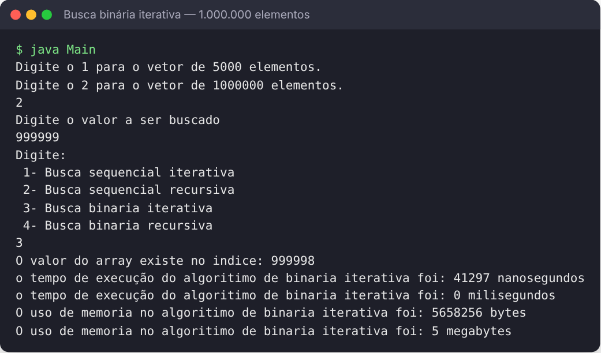

# Algoritmos de Busca em Java: tempo e memória

Programa em Java que compara **quatro algoritmos de busca** em vetores ordenados de **5.000** ou **1.000.000** de elementos, medindo o **tempo de execução** (`System.nanoTime`) e o **uso de memória** (`Runtime`) de cada um.



## Algoritmos implementados

| Opção | Algoritmo | Complexidade |
|---|---|---|
| 1 | Busca sequencial iterativa | O(n) |
| 2 | Busca sequencial recursiva | O(n), com uma chamada por elemento na pilha |
| 3 | Busca binária iterativa | O(log n) |
| 4 | Busca binária recursiva | O(log n) |

Em um teste com 1.000.000 de elementos procurando o valor `999999`, a busca sequencial iterativa levou cerca de **8 ms**, enquanto a binária iterativa levou cerca de **0,04 ms**, cerca de 200 vezes menos. Os tempos variam conforme a máquina e o aquecimento da JVM.

## Como executar

```bash
javac Main.java
java Main
```

O programa pergunta:
1. o tamanho do vetor (`1` = 5.000, `2` = 1.000.000);
2. o valor a ser buscado;
3. qual algoritmo usar (1 a 4).

> A busca sequencial recursiva em 1.000.000 de elementos pode estourar a pilha da JVM dependendo da configuração; nesse caso, aumente a pilha com `java -Xss512m Main`.

## Tecnologias

Java

---

Feito por [João Pedro Pimenta](https://www.linkedin.com/in/joao-pedro-pimenta/) durante a graduação em Ciência da Computação na UNICAP.
